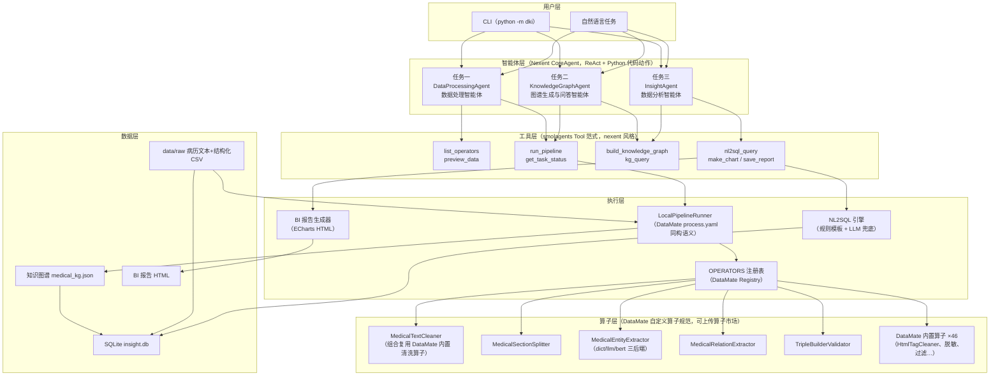
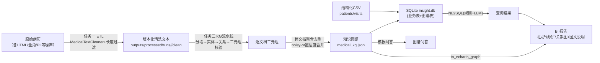

# 架构设计文档

> 项目：基于 Nexent 的"数据—知识—洞察"智能体与算子实现（dki-agents）
> 技术底座：**Nexent 智能体框架 SDK** + **DataMate 数据处理算子体系**

## 1. 总体架构



**分层解耦**：智能体（决策/编排）—工具（能力封装）—执行器（流程与状态）—算子（原子处理）
四层单向依赖，任一层可独立替换：算子可上传 DataMate 平台由 Ray 执行；智能体可换成
Nexent 平台的可视化编排；工具层无智能体时可被 CLI 直接调用（确定性模式）。

## 2. 与 Nexent 的集成点（智能体框架）

| 集成点 | 本项目位置 | Nexent 对应源码 |
|---|---|---|
| ReAct 智能体内核 | `dki/agents/runtime.py` 直接实例化 `CoreAgent` | `nexent/sdk/nexent/core/agents/core_agent.py` |
| LLM 封装 | `build_model()` 使用 `OpenAIModel`（流式 + observer） | `nexent/sdk/nexent/core/models/openai_llm.py` |
| 流式过程观察 | `MessageObserver` 贯穿模型与智能体，CLI 解析 ProcessType 渲染过程 | `nexent/sdk/nexent/core/utils/observer.py` |
| 工具范式 | 9 个工具全部为 `smolagents.tools.Tool` 子类，`name/description/inputs/output_type/forward` + observer 注入 | `nexent/sdk/nexent/core/tools/exa_search_tool.py`（范式参照） |
| 提示词三段式 | `duty / constraint / few_shots` YAML + Jinja2 渲染 | `nexent/backend/prompts/managed_system_prompt_template_zh.yaml`、`backend/agents/create_agent_info.py` |
| `<code>` 动作协议 | 系统提示词按 CoreAgent 的 `parse_code_blobs` 约定生成 | `core_agent.py` 中 `parse_code_blobs()` |
| 环境变量命名 | `LLM_API_KEY / LLM_MODEL_NAME / LLM_API_URL` | `nexent/sdk/benchmark/smoke.py` 同名约定 |

## 3. 与 DataMate 的集成点（数据处理算子体系）

| 集成点 | 本项目位置 | DataMate 对应源码 |
|---|---|---|
| 算子基类继承 | 5 个医疗算子全部继承 `datamate.core.base_op.Mapper` | `datamate/runtime/python-executor/datamate/core/base_op.py` |
| 算子注册 | `OPERATORS.register_module(module_name, module_path)` 懒注册 | `datamate/.../common/utils/registry.py` |
| 内置算子复用 | `MedicalTextCleaner` 内部编排 HtmlTagCleaner / FullWidthCharacterCleaner / ExtraSpaceCleaner / AnonymizedPhoneNumber / AnonymizedIdNumber 等真实内置算子；`load_builtin_ops()` 等价于官方镜像 `PYTHONPATH=/opt/runtime/datamate` 的挂载方式 | `datamate/runtime/ops/mapper/*` |
| 流水线语义同构 | `LocalPipelineRunner` 复刻 `RayDataset.process` 的线性链、is_first_op/is_last_op 注入、Mapper→map / Filter→filter / Slicer→flat_map、失败样本隔离语义；配置文件与 `process.yaml` 同构 | `datamate/.../core/dataset.py`、`wrappers/datamate_executor.py` |
| sample 数据契约 | text/data/fileName/fileType/fileId/filePath/fileSize/export_path/ext_params/execute_result/failed_reason 全字段一致 | `base_op.py` + `runtime/ops/README.md` §3 |
| 任务状态机 | PENDING/RUNNING/COMPLETED/PARTIAL_SUCCESS/STOPPED/FAILED | `datamate-python/app/module/cleaning/schema/cleaning.py` CleaningTaskStatus |
| 自定义算子包规范 | 每算子包 `__init__.py + metadata.yml + process.py`，`scripts/package_operators.py` 打包 zip 可直接上传算子市场（module_path 重写为 `ops.user.<pkg>.process`） | `datamate/runtime/ops/README.md`、`ops/examples/test_operator/` |
| AC 自动机复用 | 实体抽取 dict 后端复用 DataMate 的 Aho-Corasick 工具 | `datamate/.../common/utils/aho_corasick.py` |
| NPU 原生钩子 | 实体抽取 bert 后端对接 `accelerator="npu"` + `BaseOp.use_npu()`；metadata 声明 `runtime.npu` 由平台 `resources["npu"]` 调度 | `base_op.py` `is_npu_available/use_npu`、`dataset.py` `_run_single_op` |

**无 DataMate 环境的降级**：`dki/compat/datamate_base.py` 提供与 `base_op` 逐条对齐的契约
shim（见该文件 docstring 的一致性清单），`dki/dmcompat.py` 自动切换。算子代码零改动。

## 4. 数据流（数据 → 知识 → 洞察 闭环）



- 任务三同时复用任务一产出（结构化表 → SQL 分析）与任务二产出（图谱 → 关系图/图谱表查询），
  满足"前两个任务的产出被任务三有效复用"的硬性要求。

## 5. 智能体设计（任务理解 → 规划 → 执行 → 跟踪 → 恢复）

三个智能体共享同一套模式（以数据处理智能体为例）：

1. **任务理解**：自然语言任务进入 CoreAgent，系统提示词含算子清单/数据说明（duty 段）；
2. **规划**：智能体先调 `list_operators` + `preview_data` 侦察，再在思考区输出编排计划；
3. **执行**：`run_pipeline` 提交算子链（JSON 形式，与 process.yaml 同构）；
4. **状态跟踪**：`get_task_status` 返回逐算子指标（吞吐/延迟/失败明细 top3），TaskReport
   同步落盘 `outputs/tasks/<task_id>.json`；
5. **异常恢复**（三层）：
   - 算子层：单文件失败 → `execute_result=False` 隔离，不阻断整链（DataMate 语义）；
   - 执行层：可配置重试（`retry` 参数，副本上重试防半写污染）；任务终态自动归为
     PARTIAL_SUCCESS/FAILED；
   - 智能体层：constraint 提示词明确"失败诊断流程"——读 task_status 的错误明细 →
     调整参数/剔除坏样本/换算子 → 重新提交；工具 forward 永不抛裸异常，全部返回
     `{"ok":false,"error":...,"hint":...}` 结构化错误供智能体自愈。

## 6. 运行模式矩阵

| 模式 | LLM 依赖 | 用途 |
|---|---|---|
| 确定性直跑（默认 CLI） | 无 | 复现评测、CI、算子基准 |
| ScriptedModel 智能体 | 无 | 离线演示/测试完整 ReAct 循环（预置模型响应） |
| 在线智能体（--agent） | OpenAI 兼容端点 | 真实自然语言任务的自主规划与编排 |

## 7. NPU 优化设计概要

- 适配算子：`MedicalEntityExtractor(backend="bert")`（Transformer NER 推理，计算密集）；
  词典后端（AC 自动机）为访存型轻计算，不适合 NPU——报告含此分析。
- 优化手段：静态 shape 分桶 padding（避免动态 shape 反复编译）、二进制算子编译缓存、
  批处理、混合精度；与 DataMate 的 `accelerator="npu"` / `runtime.npu` 声明贯通。
- 详见 `docs/npu_optimization.md`（含 CPU/NPU 对比方法与复跑手册）。

## 8. 目录结构

```
dki-agents/
├── dki/
│   ├── compat/            # DataMate 契约兼容 shim
│   ├── dmcompat.py        # 集成开关层（真实 datamate ↔ shim 自动切换）
│   ├── pipeline/          # LocalPipelineRunner / 任务状态 / 样本契约
│   ├── operators/         # 5 个医疗算子包（DataMate 自定义算子规范）
│   ├── kg/                # 本体 Schema / 图谱存储查询 / 聚合 / 评测 / 问答 / 词典
│   ├── agents/            # Nexent 智能体 ×3 + 工具 ×9 + 提示词
│   ├── analysis/          # SQLite / NL2SQL / 指标 / BI 报告
│   ├── datagen/           # 合成病历与金标准生成器
│   ├── bench/             # 算子基准 + NPU（bert NER）基准
│   └── cli.py             # 统一 CLI
├── configs/               # process.yaml 同构流水线配置
├── data/                  # raw（生成数据）/ gold（金标准）/ nl2sql_eval.jsonl
├── scripts/               # 环境搭建 / 算子打包上市场
├── tests/                 # pytest
└── docs/                  # 本文档 / NPU 报告 / 评分点映射
```
