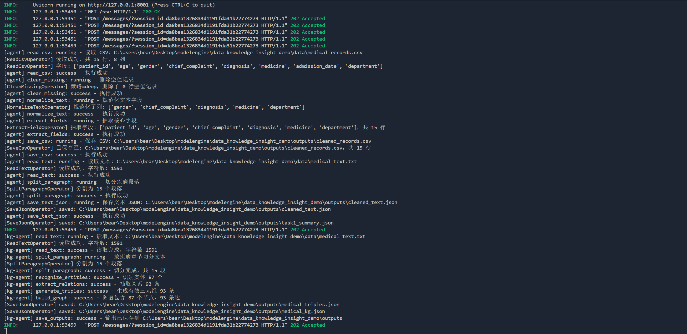
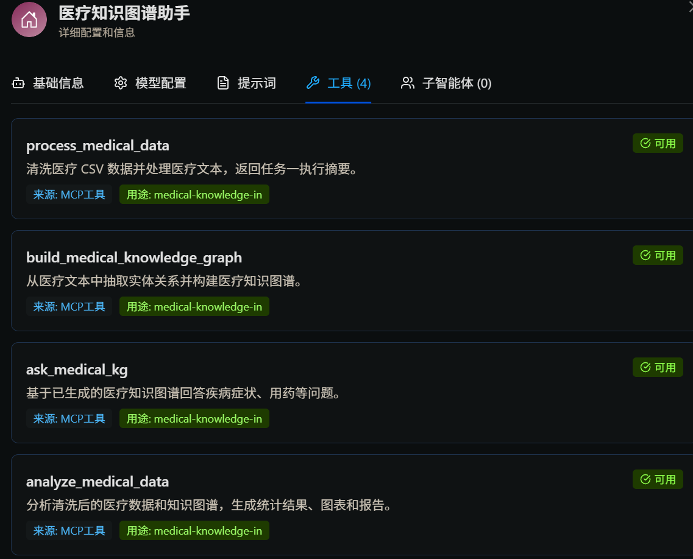
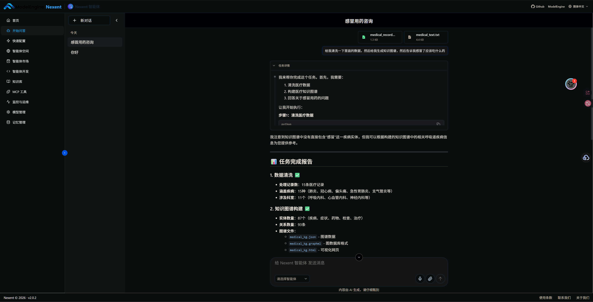
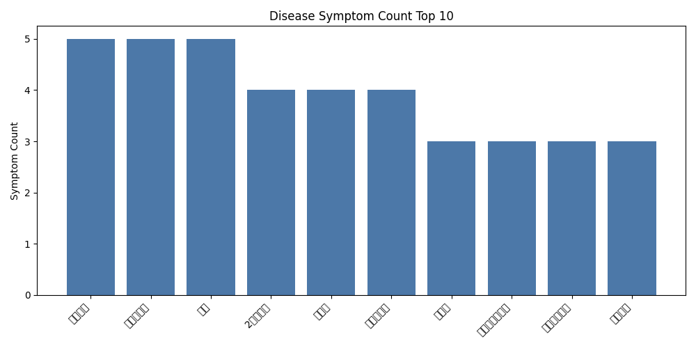
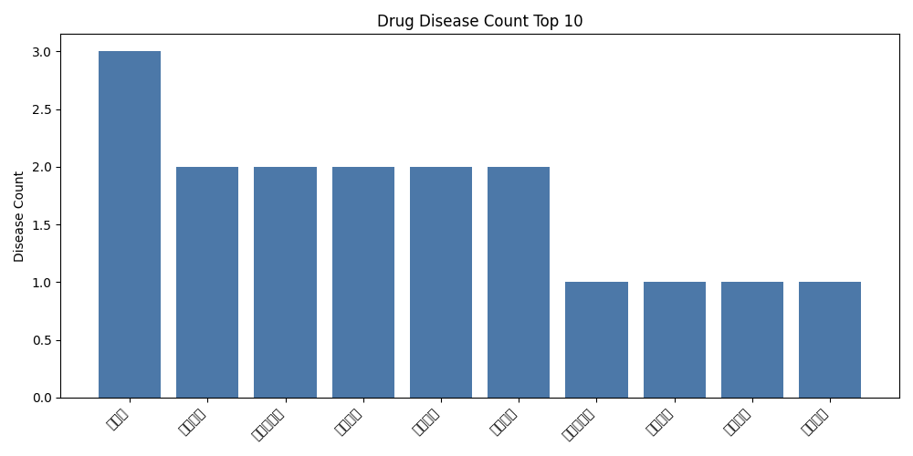
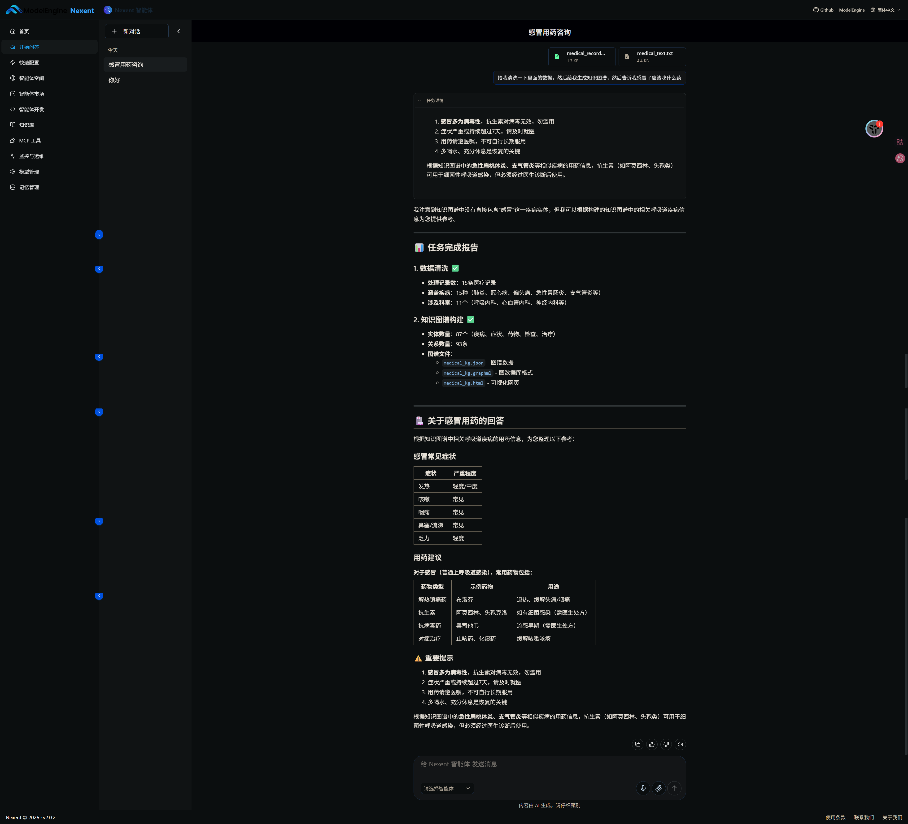

# Data Knowledge Insight Demo

基于 **DataMate + Nexent 思路**实现的"数据 → 知识 → 洞察"智能体 Demo。

这个项目面向医疗示例数据，演示如何把原始 CSV 和文本数据处理成结构化数据、知识图谱、问答能力、分析报告和可视化图表。
## AgentsHub 打包说明

本目录已按 AgentsHub 通用智能体规范整理，包含可导入的 `agent.json`、本地 MCP 配置、Skill 技能包源文件与可上传的 ZIP 包，以及运行该 Agent 所需的完整 Python 源码、示例知识库数据、依赖锁定文件和测试。

### 目录约定

```text
数据知识洞察助手/
├── agent.json                         # Nexent Agent 导入配置
├── mcps/data-knowledge-insight.json   # 本地 MCP 服务启动与地址配置
├── skills/数据知识洞察分析/            # Skill 源文件
├── skills/数据知识洞察分析.zip         # 可在 Nexent 中上传的技能包
├── data/                              # 示例知识库输入数据
├── agents/ operators/ pipelines/      # Agent、算子和流水线实现
├── outputs/                           # 已生成的可复用示例产物
├── pyproject.toml / uv.lock           # 依赖与锁定版本
└── tests/                             # 自动化测试
```

### 本地复现

在本目录执行：

```bash
uv sync
uv run python run_demo.py all
uv run pytest
uv run python -m adapters.nexent_mcp_tools
```

MCP 服务默认地址为 `http://127.0.0.1:8001/sse`。启动服务后，将该地址填入 `agent.json` 对应的 MCP 配置即可。项目不依赖外部密钥即可运行示例数据流程；真实 LLM planner 测试需按 `.env.example` 配置凭据。

医疗数据仅为演示用示例，不构成医疗诊断或治疗建议。

## 项目目标

本 Demo 用来完成一个端到端智能体任务闭环：

1. **数据处理**：读取医疗 CSV 和文本，完成清洗、字段抽取、文本规范化和结果导出。
2. **知识构建**：从医疗文本中抽取实体、关系和三元组，生成医疗知识图谱。
3. **图谱问答**：基于医疗知识图谱回答疾病症状、疾病用药、症状反查疾病、药物反查疾病等问题。
4. **数据洞察**：对图谱和清洗数据进行统计分析、NL2SQL 查询评估和图表生成。
5. **平台集成增强**：说明 Demo 算子如何迁移到 DataMate，智能体能力如何封装成 Nexent 工具。

## 当前能力

### 任务一：数据处理智能体

- 读取 `data/medical_records.csv`
- 清洗缺失值
- 规范化文本字段
- 抽取核心字段
- 读取并切分 `data/medical_text.txt`
- 输出清洗后的 CSV、JSON 和任务摘要
- 使用 `RuleBasedTaskPlanner` 将任务描述映射为 CSV-only、text-only 或 CSV+text 计划
- 提供 `LLMTaskPlanner`，支持通过真实 LLM 生成任务计划，并在输出异常时回退规则规划
- 失败时返回结构化 `failed` summary 和 `execution_state.errors`
- 支持 `StepExecutionPolicy` 配置单个 step 的 retry / required / skipped 行为

### 任务二：知识图谱智能体

- 医疗实体识别
- 关系抽取
- 三元组生成与校验
- 知识图谱 JSON / GraphML / HTML 输出
- 图谱问答 `KGQAAgent`

### 任务三：数据分析智能体

- 图谱节点、边、实体类型和关系类型统计
- 疾病症状数量统计
- 药物关联疾病数量统计
- 中心性分析
- 图表输出
- SQLite 数据库构建
- NL2SQL 模板评估

### API Demo

FastAPI 接口包括：

- `GET /health`
- `POST /task1/run`
- `POST /task2/build-kg`
- `POST /task2/ask`
- `POST /task3/analyze`

### DataMate / Nexent 集成增强

已完成：

- Demo 算子与 DataMate `runtime/ops` 结构对照
- Demo Agent 与 Nexent Agent / MCP Tool 结构对照
- DataMate 风格算子适配样例：`CleanTextDataMateMapper`
- 任务一 DataMate 风格 mapper：`NormalizeMedicalRecordMapper`、`ExtractMedicalFieldsMapper`
- 任务一 DataMate package 示例：`adapters/datamate_task1_package/`
- Nexent/FastMCP 风格远程 MCP 工具：4 个业务级工具覆盖数据处理、知识图谱构建、图谱问答和数据分析
- DataMate 集成说明文档

## 目录结构

```text
data_knowledge_insight_demo/
├── adapters/     # DataMate / Nexent 风格适配层
├── agents/       # 智能体实现
├── api/          # FastAPI 服务入口
├── data/         # 示例输入数据
├── docs/         # 任务说明、API 文档、集成说明
├── operators/    # 数据处理、知识图谱、分析、NL2SQL 算子
├── outputs/      # Demo 生成的结果文件
├── pipelines/    # 任务流水线
├── planners/     # 自然语言任务规划器
├── tests/        # pytest 测试
├── run_demo.py   # 一键运行入口
├── pyproject.toml
└── uv.lock
```

## 环境要求

- Python 3.11+
- uv

安装依赖：

```bash
uv sync
```

## 一键运行

在项目根目录运行：

```bash
uv run python run_demo.py task1
uv run python run_demo.py task2
uv run python run_demo.py task3
uv run python run_demo.py all
```

## 启动 API

```bash
uv run uvicorn api.main:app --reload
```

启动后访问：

```text
http://127.0.0.1:8000/docs
```

## API 示例

健康检查：

```bash
curl http://127.0.0.1:8000/health
```

运行任务一：

```bash
curl -X POST http://127.0.0.1:8000/task1/run \
  -H "Content-Type: application/json" \
  -d '{"task_description":"请清洗医疗数据"}'
```

图谱问答：

```bash
curl -X POST http://127.0.0.1:8000/task2/ask \
  -H "Content-Type: application/json" \
  -d '{"question":"肺炎有哪些症状？"}'
```

## 测试

运行全量测试：

```bash
uv run pytest
```

当前验证状态：

```text
56 passed
```

本次任务一增强新增了 planner、resilience、DataMate mapper 和 Nexent tool 专项测试。

真实 LLM planner 测试需要本地 `.env`：

```bash
uv run pytest tests/test_real_llm_planner.py -v
```

`.env` 已被 `.gitignore` 忽略；可参考 `.env.example` 配置 `DKI_REAL_LLM_API_KEY`、`DKI_REAL_LLM_BASE_URL` 和 `DKI_REAL_LLM_MODEL`。

## 主要输出文件

```text
outputs/cleaned_records.csv
outputs/cleaned_text.json
outputs/task1_summary.json
outputs/medical_triples.json
outputs/medical_kg.json
outputs/medical_kg.graphml
outputs/medical_kg.html
outputs/medical_qa_examples.json
outputs/medical_records.db
outputs/analysis_report.md
outputs/analysis_summary.json
outputs/charts/disease_symptom_count.png
outputs/charts/drug_disease_count.png
```

## 文档索引

- `docs/task1_data_processing_agent.md`：任务一数据处理智能体说明
- `docs/task1_enhancement_plan.md`：任务一 planner、异常处理、DataMate 和 Nexent MCP 增强计划
- `docs/task2_knowledge_graph_and_qa.md`：任务二知识图谱与问答说明
- `docs/api_usage.md`：FastAPI 使用说明
- `docs/integration_enhancement_plan.md`：DataMate / Nexent 集成增强规划
- `docs/datamate_nexent_mapping.md`：Demo 与 DataMate / Nexent 结构对照
- `docs/datamate_integration.md`：DataMate 集成说明

## DataMate 适配样例

当前已实现一个轻量 DataMate 风格适配器：

```python
from adapters.datamate_adapter import CleanTextDataMateMapper

sample = {
    "text": "  发热\n\n  咳嗽   3天。 ",
    "fileName": "record.txt",
    "fileType": "txt",
}

result = CleanTextDataMateMapper(
    remove_digits=True,
    remove_punctuation=True,
).execute(sample)

assert result["text"] == "发热 咳嗽 天"
```

它证明 Demo 算子可以迁移成 DataMate `sample -> sample` 风格算子。

任务一还提供结构化医疗记录 mapper：

```python
from adapters.datamate_task1_mappers import ExtractMedicalFieldsMapper, NormalizeMedicalRecordMapper

sample = {
    "patient_id": "P001",
    "diagnosis": " 肺炎  ",
    "medicine": " 阿莫西林   头孢 ",
}

normalized = NormalizeMedicalRecordMapper(columns=["diagnosis", "medicine"]).execute(sample)
selected = ExtractMedicalFieldsMapper(fields=["patient_id", "diagnosis", "medicine"]).execute(normalized)
```

可迁移到 DataMate 的 package 示例位于：`adapters/datamate_task1_package/`。

## Nexent / MCP Tool 样例

Demo 能力可通过 Nexent/FastMCP 风格工具触发。当前 MCP server 暴露 4 个业务级工具：

| MCP 工具 | Python 函数 | 作用 |
|---|---|---|
| `process_medical_data` | `process_medical_data_tool(...)` | 清洗医疗 CSV 并处理医疗文本 |
| `build_medical_knowledge_graph` | `build_medical_knowledge_graph_tool(...)` | 从医疗文本构建知识图谱 |
| `ask_medical_kg` | `ask_medical_kg_tool(...)` | 基于 `medical_kg.json` 回答图谱问题 |
| `analyze_medical_data` | `analyze_medical_data_tool(...)` | 分析清洗数据和知识图谱，生成统计、图表和报告 |

普通 Python 调用示例：

```python
from adapters.nexent_mcp_tools import process_medical_data_tool, ask_medical_kg_tool

result = process_medical_data_tool("请清洗医疗CSV数据，并处理医疗文本")
answer = ask_medical_kg_tool("肺炎有哪些症状？")
```

`ask_medical_kg` 需要先生成 `outputs/medical_kg.json`；`analyze_medical_data` 需要先生成 `outputs/medical_kg.json` 和 `outputs/cleaned_records.csv`。如果前置产物缺失，工具会返回结构化 `missing_prerequisite` 提示，而不是直接崩溃。

普通函数不依赖 FastMCP，测试和本地 Python 调用可以直接运行。如果要作为远程 MCP server 提供给 Nexent，需要先安装 FastMCP，然后启动 server：

```bash
uv run python -m adapters.nexent_mcp_tools
```

Nexent MCP 配置地址示例：`http://127.0.0.1:8001/sse`。如果 Nexent 在 Docker 中运行，通常使用 `http://host.docker.internal:8001/sse`。

## Nexent 集成部署指南

本节说明如何将 Demo 的 4 个 MCP 工具集成到 Nexent 平台，实现从 Nexent 界面直接调用医疗数据处理、知识图谱构建、问答和分析能力。

### 架构说明

```raw
Nexent 平台 (Docker)
    ↓ 远程 MCP 协议
Demo MCP Server (端口 8001)
    ↓ 调用
4 个业务工具
    ↓ 执行
agents/data_processing_agent.py
agents/knowledge_graph_agent.py
agents/kgqa_agent.py
agents/data_analysis_agent.py
    ↓ 输出
outputs/ 目录
```

**关键设计**：
- Demo 作为独立 MCP Server 运行，不修改 Nexent 核心代码
- 使用 FastMCP 框架，符合 Nexent 官方推荐的集成方式
- 工具始终使用本地路径，避免 Docker 环境下的 S3 路径问题

### 前置要求

- Python 3.11+
- uv（包管理器）
- Docker Desktop（运行 Nexent）
- FastMCP（已包含在依赖中）

### 步骤 1：安装依赖

```bash
cd data_knowledge_insight_demo
uv sync
```

### 步骤 2：启动 Demo MCP Server

```bash
uv run python -m adapters.nexent_mcp_tools
```

**预期输出**：
```raw
INFO:     Starting MCP server 'data-knowledge-insight' with transport 'sse' on http://127.0.0.1:8001/sse
INFO:     Uvicorn running on http://127.0.0.1:8001 (Press CTRL+C to quit)
```

**保持此终端运行，不要关闭。**

### 步骤 3：启动 Nexent（如果尚未启动）

```bash
cd ../nexent/docker
bash deploy.sh
```

按照提示选择部署模式，完成后访问 `http://localhost:3000`。

### 步骤 4：在 Nexent 中配置 MCP 服务器

1. 登录 Nexent 界面（`http://localhost:3000`）
2. 进入 **智能体开发** 页面
3. 在"选择Agent的工具"页签右侧，点击 **"MCP配置"**
4. 在弹出的配置窗口中填写：
   - **服务器名称**：`medical-knowledge-insight`
   - **服务器URL**：`http://host.docker.internal:8001/sse`
5. 点击 **"添加"** 按钮

> **注意**：因为 Nexent 运行在 Docker 中，需要使用 `host.docker.internal` 访问宿主机的端口。

### 步骤 5：创建医疗智能体

1. 在智能体开发页面，点击"创建智能体"
2. 填写智能体信息：
   - **智能体名称**：`医疗知识图谱助手`
   - **智能体变量名**：`medical_agent`
   - **大语言模型**：选择可用的模型（如 `MiniMax-M2.7-highspeed`）
   - **智能体运行最大步骤数**：`5`
   - **智能体描述**：`基于医疗知识图谱的智能助手，支持数据处理、知识图谱生成、问答和分析`
3. 点击"下一步"，在工具选择页面选择 4 个 MCP 工具：
   - ✅ `process_medical_data`
   - ✅ `build_medical_knowledge_graph`
   - ✅ `ask_medical_kg`
   - ✅ `analyze_medical_data`
4. 配置系统提示词（如果有该字段）：
```markdown
你是一个医疗知识图谱智能助手，具备以下能力：

1. 数据处理：清洗医疗CSV数据和文本
2. 知识图谱生成：从医疗文本抽取实体和关系
3. 图谱问答：基于知识图谱回答医疗问题
4. 数据分析：统计分析并生成图表

请根据用户需求选择合适的工具完成任务。
```
5. 保存智能体

### 步骤 6：测试工具调用

在 Nexent 界面中，与智能体对话测试：

**测试数据处理**：
```raw
用户：帮我清洗医疗数据
```

**测试知识图谱生成**：
```raw
用户：生成医疗知识图谱
```

**测试图谱问答**：
```raw
用户：肺炎有哪些症状？
```

**测试数据分析**：
```raw
用户：分析医疗数据并生成报告
```

### 4 个 MCP 工具说明

| 工具名称 | 功能 | 输入参数 | 输出 |
|----------|------|----------|------|
| `process_medical_data` | 清洗医疗 CSV 和文本 | `task_description` | 数据处理结果摘要 |
| `build_medical_knowledge_graph` | 从文本构建知识图谱 | `task_description` | 三元组和图谱结构 |
| `ask_medical_kg` | 基于图谱回答问题 | `question` | 答案和证据 |
| `analyze_medical_data` | 分析数据生成图表 | `task_description` | 统计结果和报告路径 |

**前置依赖**：
- `ask_medical_kg` 需要先运行 `build_medical_knowledge_graph`
- `analyze_medical_data` 需要先运行 `process_medical_data` 和 `build_medical_knowledge_graph`
- 如果前置产物缺失，工具会返回 `missing_prerequisite` 提示

### 常见问题

**问题1：端口 8000 冲突**
- 原因：Nexent 默认使用端口 8000，MCP Server 也需要端口
- 解决：MCP Server 使用端口 8001（已配置）

**问题2：Nexent 无法连接 MCP Server**
- 检查 MCP Server 是否在运行
- 检查 URL 是否正确：`http://host.docker.internal:8001/sse`
- 检查 Docker 网络是否能访问宿主机

**问题3：工具调用报错**
- 查看 MCP Server 终端的错误信息
- 检查 `data/` 目录是否有数据文件
- 检查 `outputs/` 目录权限

### 文件生成位置

工具执行后，文件会生成在 Demo 的 `outputs/` 目录：

```bash
data_knowledge_insight_demo/outputs/
├── cleaned_records.csv          # 任务一：清洗后的 CSV
├── cleaned_text.json            # 任务一：清洗后的文本
├── task1_summary.json           # 任务一：执行摘要
├── medical_triples.json         # 任务二：三元组
├── medical_kg.json              # 任务二：知识图谱
├── medical_kg.graphml           # 任务二：GraphML 格式
├── medical_kg.html              # 任务二：HTML 可视化
├── medical_records.db           # 任务三：SQLite 数据库
├── analysis_report.md           # 任务三：分析报告
├── analysis_summary.json        # 任务三：分析摘要
└── charts/                      # 任务三：图表
    ├── disease_symptom_count.png
    └── drug_disease_count.png
```

## LLM Planner 样例

```python
from planners.task_planner import LLMTaskPlanner

planner = LLMTaskPlanner(llm=your_llm_callable)
plan = planner.plan("只处理医疗文本，不要处理CSV")
```

`LLMTaskPlanner` 会校验 LLM 返回的 JSON steps；如果模型输出坏 JSON 或未知 step，会自动回退到 `RuleBasedTaskPlanner`。

## 技术栈

- Python
- uv
- pandas
- networkx
- pyvis
- matplotlib
- FastAPI
- pytest
- SQLite

## 项目状态

已完成：

- 数据处理智能体 MVP
- 医疗知识图谱智能体 MVP
- 图谱问答 MVP
- 数据分析智能体 MVP
- NL2SQL 模板评估 MVP
- FastAPI Demo
- DataMate 集成说明与适配样例
- Nexent/FastMCP 风格 4-tool 远程 MCP 适配样例
- 全量测试通过

下一步计划：

- 将 `LLMTaskPlanner` 接入 CLI/API 的可选参数
- 为任务一异常策略增加 backoff / timeout 等更细粒度控制
- 补充性能评测与 NPU 优化路径说明
- 准备答辩材料

## 效果图



### Nexent 界面效果




### 知识图谱可视化效果



### 分析报告效果



### 完整流程效果



## 说明

本项目当前采用轻量 Demo 路线：先保证端到端闭环可运行、可测试、可解释，再逐步说明如何迁移到 DataMate 和 Nexent 的真实平台结构中。
